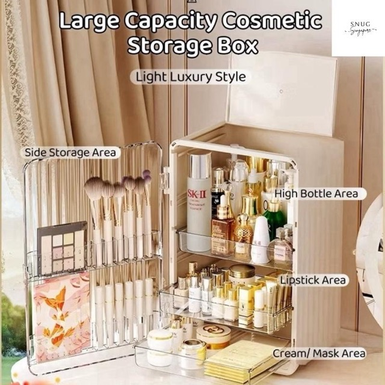
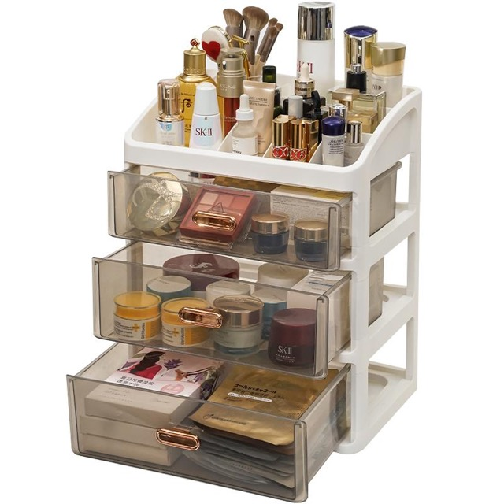
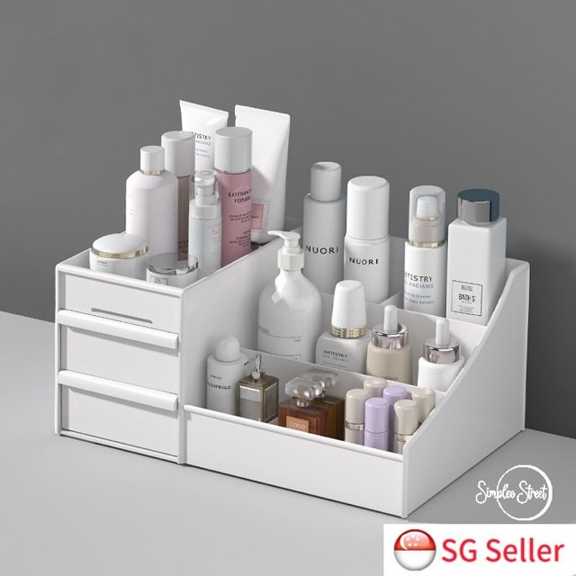
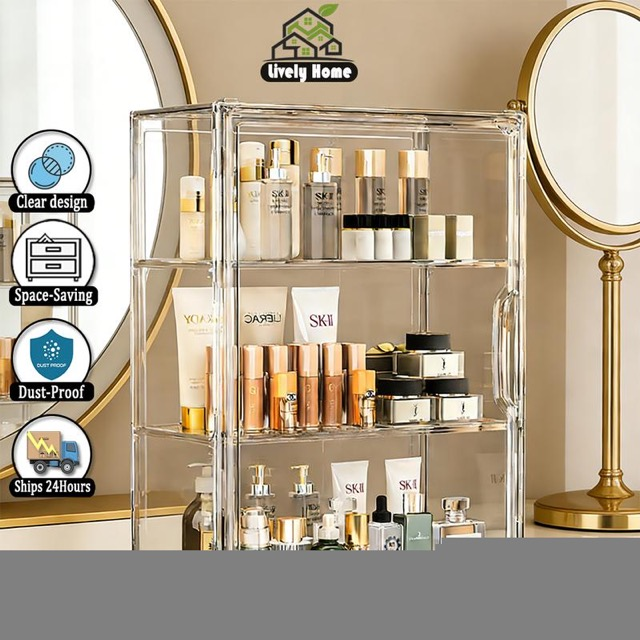
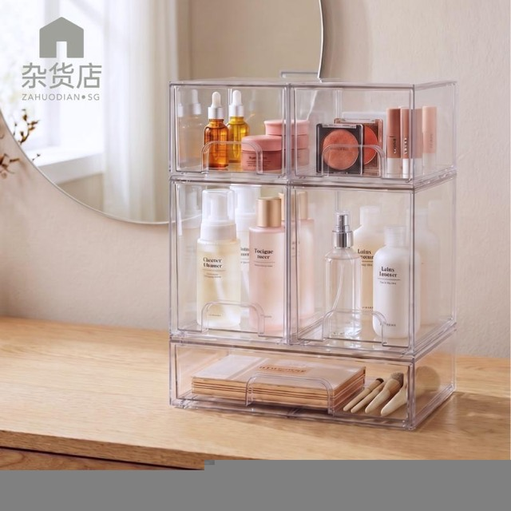
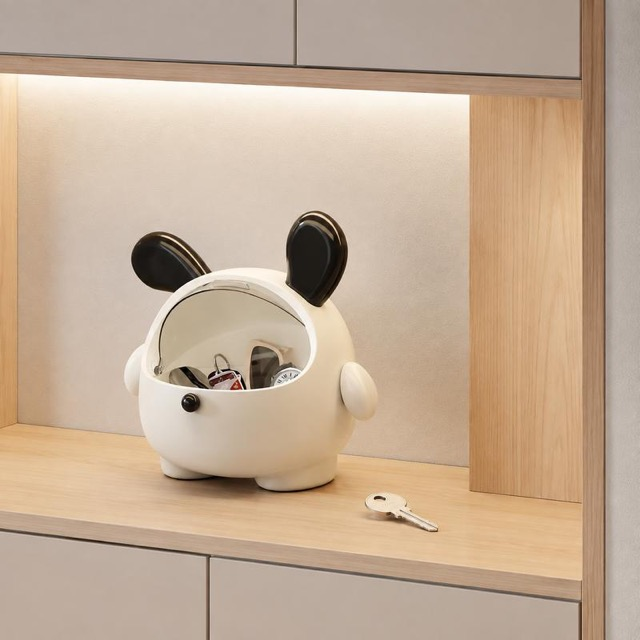

# 新加坡搜索型电商选品案例：桌面与梳妆台收纳

研究日期：2026-11-21。金额均为 SGD，除特别注明外来自 Kalodata 的 TikTok SG 数据。本文不研究达人投放。

## 1. 经营结论

**现在可以启动供应商询价和样品验证，不能据此直接备货。优先验证开放式桌面收纳，其次验证透明磁吸防尘柜；暂缓兔子造型盒和多件套模块抽屉。**

理由不是“销量最高”或“竞争最少”，而是：开放式收纳有可比较的尺寸和历史用户反馈，Simplee 的两周销量从24到29，30天商城归因收入占36.3%；磁吸柜的商城归因占77.8%，但仅18件、缺一周响应，只适合低成本验证。它们的用途、尺寸、组装和履约信息适合通过商品页表达，这是经营假设，不是已证实的搜索转化优势。

本轮最重要的发现：

| 发现 | 证据 | 经营意义 |
| --- | --- | --- |
| 同一商品家族的“低价”可能对应不同 SKU | Lazada JIAJIA 列表 S$8.91，商品页默认大号三层 S$24.81，运费 S$1.99 | 不用列表起价算毛利；先建立 SKU 对照 |
| 收纳痛点不只是外观 | 原始评论出现门关不严、尺寸预期落差、运输损坏、需要组装 | 差异化先放在尺寸表达、结构和售后，不能只换颜色 |
| 30天高销量不等于稳定需求 | 兔子盒30天264件，两周33→10；收入下降71.1% | 暂缓备货，补更长窗口和搜索平台成交证据 |
| TikTok 的成交不能直接搬到 Lazada/Shopee | SNUG 收入97.2%视频归因；模块抽屉100%直播归因 | 这些数据只是发现线索，不是搜索平台需求验证 |
| 评论不是本次两周销量的解释变量 | 返回384条，296条有文本；第二周无返回评论 | 可以发现历史风险，不能归因本次涨跌 |

**未证明：**新加坡市场规模、全平台竞争强度、同规格商品的销量优势、供应链价差、盈利能力、复购率，以及本地仓对销量的因果影响。

## 2. 为什么从这些产品开始

你希望从搜索型平台的商品、价格和卖家入手。因此本轮选择“梳妆台整理”和“桌面／小空间整理”作为探索入口：功能容易用实物、尺寸、分区和盖门结构描述，可以比较同用途的不同解决方式。

这是研究者的入口选择，并非 API 判断它们是最佳类目。“生活美学”本身也不是一个被验证的需求分类。为了控制成本，先试 S$5–40 的周期均价范围和家居收纳分类；这个价格范围是探索条件，不是已证实的价格甜点区。它也不保证商品所有 SKU 都在 S$5–40 内。

### 2.1 发现过程与选择偏差

共同条件：SG、SGD、中文返回、2026-10-21至2026-11-19（含首尾30天）、每页最多100条、第一页。特意不含采集当天；这不是已确认的 Kalodata 更新延迟规则。

| 步骤 | 查询 | 返回 | 新增信息／问题 |
| --- | --- | --- | --- |
| 1 | 家居收纳851848，关键词 makeup，收入降序 | 6条 | 混入旅行化妆包；没有发现 SNUG |
| 2 | 同条件，改销量降序 | 同6条、同顺序 | 未增加样本，花费0.1积分 |
| 3 | 同分类，关键词 desk，收入降序 | 2条 | 主要是桌下抽屉／理线托盘，并非梳妆台收纳 |
| 4 | 同条件，改销量降序 | 同2条、同顺序 | 未增加样本，花费0.1积分 |
| 5 | 收纳盒600621，无关键词，收入降序 | 100条 | 找到 SNUG；也混入耳机壳、清洁剂、镜子等异用途产品 |

5次查询共116条返回记录，按 `product_id` 去重为**107款**。只有 JIAJIA 同时进入关键词结果和这100条分类结果。100条只是当前筛选条件下第一页，不是全市场，也不是随机样本；分类和关键词均不能自动保证同用途。两种排序返回相同结果，不能据此确认后台真的执行了排序。

完整台账：[107款筛选记录](../generated/sg-storage-screening.csv)。含原始名称、卖家ID、卖家名、30天收入／销量／均价、分类榜位置、来源响应文件名及本轮处理理由。

台账标记是研究者判断，不是算法评分：6款深查；19款保留为备选；另有用途不符／用途未确认、标题过于笼统的记录。未深查不等于市场淘汰。所有名称筛选均未经逐款规格认证。

### 2.2 为什么是这六款

| 标签 | 分类榜位置 | 纳入原因 | 不可偷换的比较口径 |
| --- | --- | --- | --- |
| SNUG E-B001 | 1 | 高收入的大容量带门柜，作为结构／质量对照 | 不等于搜索平台销量冠军 |
| JIAJIA | 5 | 关键词命中、高销量、多抽屉，且找到同名 Lazada 卖家家族 | 多规格成交不能当成一个固定 SKU |
| Simplee SH288 | 23 | 低价开放式分区加抽屉，规格文字相对完整 | 与带门柜不同结构、不同容量 |
| LivelyHome | 76 | 透明磁吸防尘柜，较低销量的结构对照 | 不是因销量低就有机会 |
| Za Huo Dian | 83 | 可堆叠模块抽屉，验证组合与规格复杂度 | 套装／两件装不能混算单件价格 |
| MORI SPACE | 3 | 高销量、造型明显、跨境标签的小物盒，检验美学与实用落差 | 不是护肤品柜的同规格竞品 |

这是覆盖几种解决方式的目的性样本，**不是107款中最好的六款**。例如 Good Home Furniture 的混合用途收纳架有93件、S$1,320.49；Lioren 透明梳妆台柜有12件、S$339.26；Like-it 模块抽屉有36件、S$326.30，都未做本轮详情深查。它们被保留，不能声称已被排除。

旅行袋、桌下托盘、镜子、盲盒展示柜等只说明搜索／分类边界有污染，不是同用途收纳的直接竞争者。关键词结果只有6或2条，更不能解释为竞争很少。

## 3. 六款实物与规格核对

以下为卖家主图的640像素缩略图，采集于2026-11-21，用于本报告的商品比较与评论。图片、材质、尺寸与发货速度均不构成独立实测。权利归原权利人，未确认公开再分发授权；本报告不授予读者任何图片使用许可，图片不作为可再利用的素材提供。

### 3.1 SNUGSG E-B001

商品ID：`1733112519268992114`；卖家 SnugSG，店铺ID `7494985619923044466`。

图片显示侧门、瓶区和分层收纳。卖家文字尺寸28.5×20.5×41.5cm，材质HIPS+PS+TPE，另有“clear PS”表述；尺寸的长宽高顺序及不同部件材料需确认。详情称“一体成型、无需组装”，但返回评论有“Easy to assemble”和收到后安装的描述。可能涉及不同 SKU、详情复用或表述错误，不能任选一方当真。

建议：作为门结构、安装体验和售后风险的样品对照，不按其 TikTok 销量直接照搬。

### 3.2 JIAJIA HOME MART

商品ID：`1729570469485839492`；店铺ID `7494922634789685380`。

主图是开放顶层加三层抽屉，标题含 dustproof 不能解释成顶层全封闭。TikTok 详情文字描述为空，未取得尺寸；评论涉及至少4个 SKU。Lazada 商品页出现同名卖家、多种层数及大小，是商品家族线索，仍未验证 TikTok SKU 与 Lazada SKU 一一对应。

建议：拿来建立规格—售价对照，并核对容量表达和可更换抽屉／配件；不能用30天均价S$10.50认定图中大号三层售价。

### 3.3 Simplee Street SH288

商品ID：`1729553854526358948`；店铺ID `7495308351528995236`。

卖家称塑料，粉／绿／蓝／白；小号26.5×16×11.5cm，大号28×17.5×12.3cm。图片展示瓶区、抽屉和分区，并不保证每个规格都与图相同。卖家称新加坡库存、1–2工作日发货、1–3日送达、气泡包装，未独立核验；重量未取得。

建议：优先询同尺寸、同抽屉布局的供应商报价和包装体积。低售价意味着履约费用容忍度可能更低，尚无净利润证据。

### 3.4 LivelyHome.sg 磁吸柜

商品ID：`1734257482384245988`；店铺ID `7496149186466973924`。

卖家称 acrylic、磁吸防尘门、两块可调层板，27W×14D×36Hcm，手工测量误差1–2cm。图片中的“Ships 24Hours”仅为卖家宣称；评论提及需自行组装。

建议：次选询价对象，重点核对板厚、门缝、连接件、净内尺寸和组装说明。低样本量与一周响应缺失使其不能被认定为稳定需求。

### 3.5 Za Huo Dian 模块抽屉

商品ID：`1733788464777233807`；卖家 Za Huo Dian Singapore，店铺ID `7495582677719222671`。

文字描述涉及5件全套、2件短／高／长规格及防滑贴，未取得各模块尺寸。图中整套不能解释成任何两件装；当前SKU区间S$28.80–68.56，30天均价仅S$20.00，尚未解释这一差异。

建议：暂缓备货，先取得模块尺寸、套装清单、每组合重量和价格。评论说明多用途和堆叠有价值，但不支持把所有组合混成一个单位。

### 3.6 MORI SPACE 兔子造型盒

商品ID：`1737239825686562474`；店铺ID `7494801243739096746`。

卖家称PP+PET，约24.2×19×23cm；标题写 sliding lid，正文写 flip cover，主图无法确认实际开盖机构。评论既有“容量够大”，也有内部空间偏小、连接处运输断裂；不同 SKU 与个人用途可能解释部分差异，需实物验证。

建议：暂缓作为第一款。先测净容积、盖门／连接件和包装，不把可爱造型、高30天销量视为持续的搜索需求。

## 4. 同用途、卖家与发货方式：API 实际给了什么

30天窗口为2026-10-21至11-19；收入是平台数据字段，不是商家到账、毛利或利润。`sales_volumn` 记作销量件数，不是唯一买家数或订单数。

| 商品 | 收入 S$ | 销量件 | API周期均价 S$ | 当前SKU最低–最高 S$ | 配送标签 | 商城归因占比 |
| --- | ---: | ---: | ---: | --- | --- | ---: |
| SNUG | 4625.18 | 229 | 20.20 | 22.00–23.00 | local | 0.0% |
| JIAJIA | 2310.21 | 220 | 10.50 | 10.27–30.09 | local | 7.9% |
| Simplee | 694.08 | 99 | 7.01 | 6.71–9.69 | local | 36.3% |
| LivelyHome | 306.00 | 18 | 17.00 | 12.42–12.42 | local | 77.8% |
| Za Huo Dian | 280.02 | 14 | 20.00 | 28.80–68.56 | local | 0.0% |
| MORI SPACE | 2840.53 | 264 | 10.76 | 14.77–15.24 | global | 0.0% |

API 能取得商品和卖家身份、周期收入销量、价格字段、SKU数量、配送标签及评论的SKU ID；本轮没有取得逐SKU周期销量和成交价，也没有完成同规格认证。

`local/global` 是数据商的履约标签，不证明卖家的国籍、库存所在地、海外仓所有权、真实送达时间或运费。没有相同 SKU 的本地／跨境对照，不能得出“本地发货更好卖”或“跨境便宜所以机会大”。

**“同用途比较”可以先做，“同规格销量比较”本轮做不到。**先固定物理结构、尺寸、材料、每套件数，再补SKU级证据；不同层数、盖门结构和套装单位不能只按一个销量或均价排名。

API当前价格与历史成交均价在数款上不一致：SNUG／模块抽屉／兔子盒均价低于当前最低价，LivelyHome均价高于当前最高价。可能与促销、SKU组合、价格变化或数据口径有关，未确认原因；不能推断虚假定价，也不能据此算套利空间。

商城归因收入不等于站内搜索收入，更不等于没有内容参与。此字段仅用于比较对内容渠道的依赖线索：SNUG视频97.2%、JIAJIA视频78.2%、Simplee视频63.7%、LivelyHome视频22.2%；模块抽屉直播100%，兔子盒视频100%。这些为TikTok的窗口归因，不是因果或跨平台需求证明。

## 5. 固定商品、两个不重叠时间段是什么意思

**不是拿两个不同商品比较，而是同一个 `product_id`，分别查两个等长且互不重叠的自然日窗口。**

- A：2026-11-06至11-12，含首尾7天。
- B：2026-11-13至11-19，含首尾7天。
- 地区SG、币种SGD、商品详情端点保持一致。自然日查询的服务端时区与回填规则未独立确认。
- 使用窗口汇总 `revenue` 和 `sales_volumn`，不使用金额单位尚有疑问的 `revenue_trend` 数组。

例如SNUG：A售60件、收入S$1,180.18；B售64件、收入S$1,308.56。销量多4件，收入多S$128.38，而不是两周共124个不同买家。

| 固定商品 | A收入 S$ | A件数 | B收入 S$ | B件数 | 收入变化 | 件数变化 | A→B派生均价 S$ |
| --- | ---: | ---: | ---: | ---: | ---: | ---: | --- |
| SNUG | 1180.18 | 60 | 1308.56 | 64 | +10.9% | +6.7% | 19.67→20.45 |
| JIAJIA | 488.09 | 47 | 269.98 | 33 | -44.7% | -29.8% | 10.38→8.18 |
| Simplee | 165.76 | 24 | 202.52 | 29 | +22.2% | +20.8% | 6.91→6.98 |
| LivelyHome | 129.71 | 7 | 缺失 | 缺失 | 不计算 | 不计算 | 18.53→缺失 |
| Za Huo Dian | 40.02 | 2 | 79.68 | 4 | +99.1% | +100.0% | 20.01→19.92 |
| MORI SPACE | 311.07 | 33 | 89.75 | 10 | -71.1% | -69.7% | 9.43→8.98 |

变化率为 `(B/A-1)×100%`；派生均价为窗口收入／销量，展示保留两位小数。基期为0或响应缺失时不计算相对变化。商品ID固定，**SKU销售组合并没有固定**，均价变化可能是规格组合变化，不等于同一SKU降价。

可作的观察：Simplee收入和件数同步小幅上升，均价变化较小；JIAJIA收入降幅大于件数降幅，均价也下降，需要查促销和SKU组合；模块抽屉翻倍只多2件，基数极小，不能称爆发增长。

**不能作的结论：**A含11.11促销期，B不含；没有投放、库存、流量、优惠和SKU构成数据，不能把涨跌归因于产品质量、发货方式或平台需求。两周远不足以证明稳定性。LivelyHome的B响应中断，缺失不是零销量；失败请求未重查。

## 6. 原始评论：用来找风险，不替代销量

每款只调用评论第一页、最多100条；API声明按时间倒序，没有本轮指定日期／评分过滤。共384条，296条有文本，88条为空；17条为1–3星，其中14条有文本。按 `review_id` 核对无重复；返回country均为SG，但没有已验证购买字段，不能认证为新加坡真实购买者。模板化文本、评分与文字不一致、空文本均保留统计。

| 商品 | 返回／有文本 | 1–3星／其中有文本 | 涉及SKU数 | 日期覆盖（SG时间） | A／B周评论数 |
| --- | --- | --- | ---: | --- | --- |
| SNUG | 100／68 | 7／7 | 2 | 2026-08-13至10-25 | 0／0 |
| JIAJIA | 100／71 | 3／2 | 4 | 2026-08-03至11-08 | 5／0 |
| Simplee | 100／73 | 4／2 | 8 | 2024-11-03至2026-09-22 | 0／0 |
| LivelyHome | 22／22 | 2／2 | 1 | 2026-02-16至11-09 | 1／0 |
| Za Huo Dian | 32／32 | 0／0 | 4 | 2026-01-12至10-29 | 0／0 |
| MORI SPACE | 30／30 | 1／1 | 2 | 2026-10-03至11-06 | 2／0 |

API时间戳按文档的epoch秒换算为UTC+8。Simplee评论并非本次30天；所有商品第二周均未返回评论，这可能是覆盖／更新局限，不能推出那一周没有买家评价。详情的总评论数也不等于本次返回数，例如模块抽屉详情34条、接口返回32条；未补抓或强称完整。

### 6.1 可追溯的短评证据

下列为原文节选，省略处不改变语义。中文解读是研究者判断，不是自动关键词分类；同时展示低星及含问题的高星，避免把5星当作无缺陷。评论ID为证据定位符，不列买家姓名。

| 商品／SG日期／星级 | 短原文 | 评论ID／SKU ID | 应验证什么 |
| --- | --- | --- | --- |
| SNUG／2026-09-13／2星 | “Door unable to close properly without support.” | `7684839318696740628`／`1733112519207388274` | 门关闭、支撑、装配稳定性 |
| SNUG／2026-09-23／1星 | “Missing item message also no response.” | `7688605737844836104`／`1733112519207453810` | 配件清点、客服和缺件补发 |
| JIAJIA／2026-10-14／2星 | “The vidro show much bigger size but the product is small.” | `7696503867523696391`／`1729570473167324292` | 原文相邻空格已合并；核对真实尺寸与展示预期 |
| JIAJIA／2026-10-09／5星 | “Bought two and one of them came with some damage.”；“promptly send replacement parts” | `7694331539351357202`／`1729570473167520900` | 运输损坏与替换配件，不能因5星忽略问题 |
| Simplee／2025-05-29／3星 | “Abit small....but look like ok” | `7509854627718973191`／`1729553854526424484` | 老评论，仅支持容量表达风险线索 |
| LivelyHome／2026-10-08／3星 | “Looks ok but need to fix it yourself.” | `7694266155750016769`／`1734257545431057636` | 是否需要组装、时间、工具和说明 |
| Za Huo Dian／2026-10-29／4星 | “The transparent design makes it easy to see the contents” | `7701987339693803272`／`1733788463981299087` | 透明可视、可堆叠的使用价值，不是销量证明 |
| MORI SPACE／2026-11-03／3星 | “But not proper packing the joint was break-off” | `7703733465954469638`／`1737240263883392682` | 连接件强度、缓冲与运输测试 |
| MORI SPACE／2026-10-28／5星 | “Very cute but inner space quite small.” | `7701665486656063253`／`1737240263883327146` | 净容积与适用物品，不只展示外观 |

不能拿这些样本估算全体故障率，不能比较谁“口碑最好”，也不能证明缺陷导致本次销量下降。未翻译的多语种评论不作确定性判断。

## 7. 搜索平台价格核验：Lazada SG

2026-11-21实际浏览的[Makeup Organizer列表](https://www.lazada.sg/tag/makeup-organizer/)按Best Match显示24,189个结果。这个宽泛结果数混有旅行包、置物架、配件等，不能当作同规格卖家数、有效竞争者数或市场规模。下面记录的是页面可见观察，不是Google缓存摘要。

| 页面 | 可见价格 S$ | 可见“sold” | 核验深度 |
| --- | ---: | --- | --- |
| [JIAJIA收纳商品](https://www.lazada.sg/products/pdp-i3020653974.html)的列表卡片 | 8.91 | 865 sold，295评价 | 起价；不是固定SKU价；sold无已确认时间窗口 |
| 同一商品详情，默认选中L 3 Layer(2T1S) | 24.81 | 不拿卖家总销量当商品销量 | SKU级挂牌价；SKU `3020653974_SGAMZ-20618256725` |
| [GTHome透明门桌面柜](https://www.lazada.sg/products/pdp-i3470057776.html)列表卡片 | 16.90 | 20 sold | 仅同用途线索，未核对详情、规格或实际卖家 |
| [透明磁吸亚克力柜](https://www.lazada.sg/products/pdp-i3623744397.html)列表卡片 | 12.90 | 9 sold | 仅结构线索，未认证与LivelyHome同型号 |

JIAJIA详情页卖家为JiaJia Home Mart，规格选项包括M三层、L两层、L三层不同组合，以及Mask Acrylic Box。页面材质字段写ABS，但其他自动规格字段出现Vanity Case、Magnetic Snap等，不能全部当实物认证。该页可见运费S$1.99、预计11月24–26日送达、15日退货、无保修；没有完成下单，也没有验证指定邮编和所有优惠条件。

默认大号三层的**页面商品价加运费为S$26.80**，不是已付款到手价。S$8.91对应哪一个最低价SKU未成功完成交互核验，不推断它一定是Mask Acrylic Box，也不指称低价欺骗。

TikTok JIAJIA30天均价S$10.50与Lazada大号三层S$24.81不能直接相减算利润：前者跨SKU、跨时间的成交汇总，后者是一个当前SKU挂牌价。需要实物／尺寸、SKU映射、优惠、平台费用和运费全部一致，才可能比较。

**目前只有一个Lazada商品家族完成详情级价格核对。**其他两条是列表级参考，不是完整竞品价格带。未完成Shopee/Amazon同规格核验，也没有搜索平台固定时间窗销量；本报告不是已验证的搜索市场机会报告。

## 8. 怎样把证据变成采购和测试决策

### 8.1 先做两份供应商询价，不先买库存

第一份：Simplee相邻的开放式分区／抽屉收纳。第二份：LivelyHome相邻的透明磁吸门柜。每份要求供应商分别列出单一型号，不接受“起价”和不说明组合件数的报价。

| 必须补齐 | 为什么 |
| --- | --- |
| 型号、实物图、外尺寸与净内尺寸、层板间距、每套件数 | 解决评论的容量预期落差，固定SKU单位 |
| 材质分部件说明、板厚、门／抽屉连接方式、重量 | 判断与原图是否同规格及结构耐用性 |
| 是否预装、组装步骤、工具、备件和补发政策 | 避免“无需组装”与实际不符，控制售后 |
| 包装尺寸、单件毛重、每箱数量、缓冲与测试说明 | 尺寸重量决定计费，低单价不代表低履约费 |
| MOQ、样品费、阶梯单价、币种、贸易条款、交期 | 只有正式报价才能算采购成本 |
| 目的地SG的头程、清关、税费、末端、退货处理 | 本地／跨境标签没有提供这些成本 |
| 相关合规与材料文件、商标／造型授权 | 不能从API或卖家图片推断合规和授权 |

### 8.2 条件式经济账，不编造净利润

对一个固定SKU，定义单件贡献：

`卖家实际销售收入 − 采购成本 − 包装 − 头程/清关/适用税费 − 仓储及拣配 − 卖家承担末端 − 平台/支付费用 − 广告获客 − 预计退款/破损/补发损失`。

这里不是净利润，尚未扣固定人工等费用。GST、进口申报和平台扣费须按实际经营主体与履约模式确认，不能统一直接除以1.09。API的佣金比例也不是平台全部费用。

示例仅演示报价上限，**不是实际成本或盈利预测**：假设卖家可用销售收入S$12，除到岸商品成本外的变动成本S$5，要求单件贡献S$2，则到岸商品成本上限是S$5。如果其他成本升到S$7，上限就降到S$3。S$12／5／2／7都是测试假设，不能引用为行业事实。

当前采购、包装计费、平台费和退货损耗均未完整取得，所以不能给出“值得进货价”或正毛利承诺。

### 8.3 小批量测试和停止条件

1. 先把Lazada与Shopee各平台至少5条真正同用途、同结构／尺寸相近的SKU固定下来，记录售价、优惠条件、邮编运费、卖家与发货承诺。5条是本项目操作目标，不是统计代表性标准。
2. 供应商报价和成本口径通过后再考虑样品；在获得额外采购授权前，本轮不下单。用实际常见瓶子／小物测净空间，核对抽屉、门缝、配件、安装和包装。运输强度测试方法与合格标准应先约定，不能靠随意摔一次认证。
3. 若样品与成本都通过，再另行批准20–30件、14天的搜索平台小测试；这是控制损失的操作假设，不是本轮已开展或证明有效的样本量。不使用达人路线。
4. 跟踪实际成交SKU、折扣后收入、平台费、广告、运费和售后；流量不足时只说明曝光证据不足，不能判定没有需求。

停止／暂缓条件：拿不到同型号规格和报价；供应商材料／授权／必要合规文件无法解释；结构或包装无法达到约定标准；保守成本情景下单件贡献不满足事先设定目标；测试依赖不可持续补贴才能成交。不要用高TikTok收入覆盖这些门槛。

## 9. 费用、来源与复核

### 9.1 本轮费用

| 调用 | 次数 | 估计单价（积分） | 本轮金额 |
| --- | ---: | ---: | ---: |
| 商品榜单 | 5 | 0.10 | 0.50 |
| 30天详情 | 6 | 0.10 | 0.60 |
| 两周详情尝试 | 12（11完整、1中断） | 0.10 | 1.20 |
| 原始评论 | 6 | 0.01 | 0.06 |
| 图片API、达人、视频、评论洞察 | 0 | 未调用 | 0 |
| 合计 | 29次付费尝试、28完整响应 |  | **2.36积分** |

余额：14.00→11.64，差额2.36。采集当日消费记录39行、合计3.36积分，包含上一轮1.00；本轮不能把3.36全算成新费用。最后新增10条消费与4个详情、6个评论一致。中断详情保留未知响应、未重试；总差额与包含该0.10尝试的估计一致。各记录的`actual_credits`仍为空，账单审计独立保存。

本轮预算锁定3积分、40次尝试，未使用的预算0.64。预算是本地估计防护，不是供应商硬扣费上限；失败也算尝试。余额／账单接口免费。主图从已返回URL下载，没有调用收费图片端点；无需使用5分钟到期的图片链接。

### 9.2 本地证据索引

原始数据保存在被Git忽略的 `data/raw/kalodata-search-case-2026-11-21`。以下文件名只供本地定位，不是公开GitHub下载链接，不包含密钥或买家姓名。

| 内容 | 响应文件名 |
| --- | --- |
| makeup两排序 | `5b910a82a4b34d87.json`、`aee8d42eb4f1ad48.json` |
| desk两排序 | `c79e49f9e1c1c567.json`、`9e32b5af4b53f4d0.json` |
| 收纳盒100条 | `ad145dded06cb181.json` |
| SNUG／JIAJIA／Simplee 30天 | `ea9660d2118f5bd1.json`／`c7da3199f9beeee4.json`／`32c6079d6c49441d.json` |
| LivelyHome／模块抽屉／兔子盒 30天 | `df16dc3090abaf65.json`／`4161a8fdb3423afe.json`／`bdde30ef22d7052c.json` |
| SNUG A／B | `883492704e3cfa78.json`／`3e0213818564c5c2.json` |
| JIAJIA A／B | `5c05647bce7613b4.json`／`63b040d70c4ae40a.json` |
| Simplee A／B | `7f127733da6edd86.json`／`923371f045b24f48.json` |
| LivelyHome A／B中断 | `2815ae108b68904c.json`／`0aa77982aa8cd9f6.json` |
| 模块抽屉 A／B | `7e30a23ffa7956be.json`／`fecb65b961a0149d.json` |
| 兔子盒 A／B | `c694acd5d3c2ad5c.json`／`52a2aa8c11c86612.json` |
| 六款评论：SNUG／JIAJIA／Simplee | `c40e9c971d75a2c2.json`／`d25e1e48ba9f720f.json`／`555255ffbbbb7400.json` |
| 六款评论：LivelyHome／模块抽屉／兔子盒 | `fcaed90997f3fd98.json`／`c818980fc8a7416d.json`／`76249bff65aab7f2.json` |
| 审计 | `audit/before.json`、`audit/after.json`、`audit/after-logs.json`、`audit/budget.json` |
| 派生数据 | `audit/analysis.json`；另见完整筛选CSV |

公开接口口径参照[Kalodata官方CLI](https://github.com/sailtonight/kalodata-skill)与[官方计价页](https://www.kalodata.com/open-center/pricing)。CLI参考提交`6900ef27ceaae636dcde4dfeae3af9a1e171f917`。详细的每日趋势金额缩放不确定性保留在[前一轮报告](life-aesthetics-research.md)，本轮不靠趋势金额作结论。

离线复核脚本：[scripts/analyze_search_case.py](../scripts/analyze_search_case.py)。在仓库根目录运行 `python3 scripts/analyze_search_case.py`，只读本地响应，不调用API；重建筛选CSV和审计摘要，并检查去重数量、评论时间顺序、5组完整周对照、缺失值与余额差额。它依赖私有原始文件，公开克隆仓库无法单独重建。

Lazada观察来自本次浏览器页面，并非自动持续监测；商品、价格、默认规格和配送条件随时会变。报告、研究缩略图、筛选台账和复核脚本随本次提交发布至GitHub；原始响应、账户配置和完整原图仍仅保存在本地。本次未更新GitHub Pages网页。

**下一步决策：**先补固定SKU的搜索平台价格与供应商报价，验证开放式收纳和磁吸柜的规格、结构、包装及单件贡献。当前证据支持继续验证，不支持直接认定盈利机会。